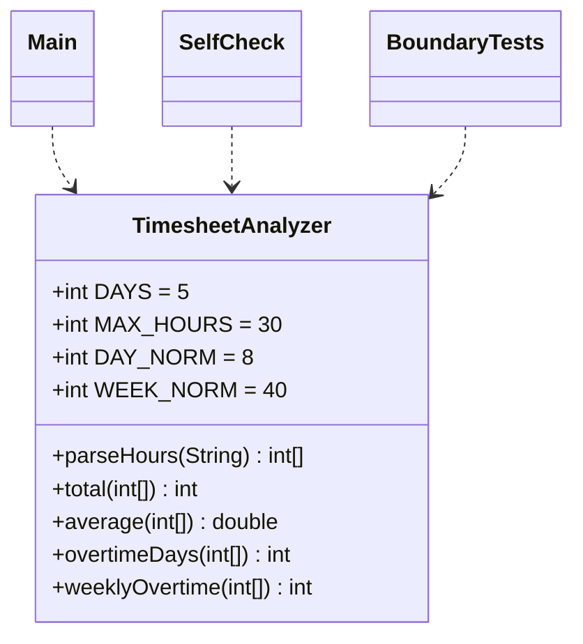

# Диаграммы работы №5

## Activity

```mermaid
flowchart TD
  s(["Начало"])
  input["Получить строку часов"]
  count{"Строка не null и ровно 5 полей?"}
  init["Создать int[5]; i = 0"]
  loop{"i меньше 5?"}
  parse["trim; проверить формат; Integer.parseInt"]
  valid{"Число распознано и находится в 0..30?"}
  inc["hours[i] = число; i++"]
  calc["total; average; overtimeDays; weeklyOvertime"]
  report["Вывести сумму, среднее, дни и часы переработки"]
  end(["Завершение"])
  err["Ошибка: число полей или позиция неверного дня; расчёта нет"]
  s --> input
  input --> count
  count -->|"да"| init
  count -->|"нет"| err
  init --> loop
  loop -->|"да"| parse
  loop -->|"нет"| calc
  parse --> valid
  valid -->|"да"| inc
  valid -->|"нет"| err
  inc -->|"цикл"| loop
  calc --> report
  report --> end
```

## Классы



В диаграмме классов перечислены прикладные типы и точки запуска проверок. Методы доступа сокращены. Файлы PNG и SVG в `diagrams/` можно открыть без поддержки Mermaid.
