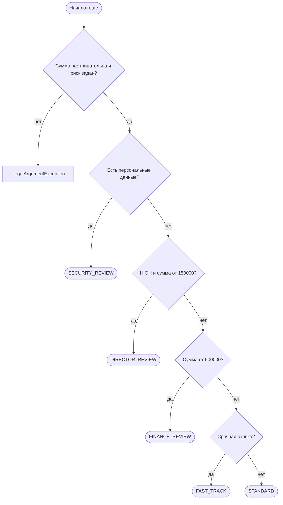

# Маршрут согласования

## Таблица решений

| Сумма | Срочно | Риск | Персональные данные | Маршрут |
|---:|:---:|---|:---:|---|
| 0 | нет | LOW | нет | STANDARD |
| 499999 | да | LOW | нет | FAST_TRACK |
| 500000 | да | LOW | нет | FINANCE_REVIEW |
| 500001 | нет | LOW | нет | FINANCE_REVIEW |
| 149999 | да | HIGH | нет | FAST_TRACK |
| 150000 | да | HIGH | нет | DIRECTOR_REVIEW |
| 150001 | нет | HIGH | нет | DIRECTOR_REVIEW |
| 500000 | да | HIGH | нет | DIRECTOR_REVIEW |
| 10000 | да | LOW | да | SECURITY_REVIEW |
| 500000 | да | HIGH | да | SECURITY_REVIEW |

Порог риска 150000 принят по трактовке из DECISIONS.md.
