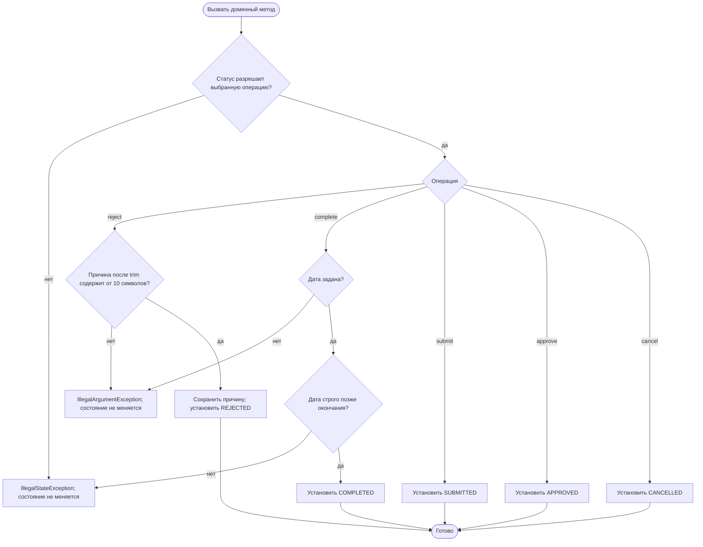
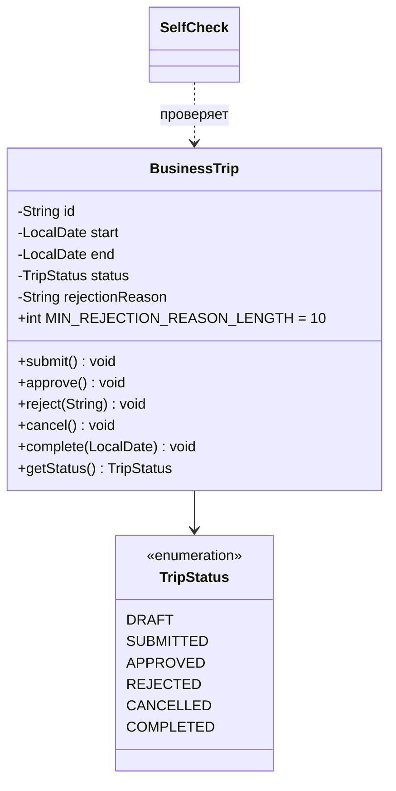

# Диаграммы

## Activity

## Классы

## Переходы состояний

| Статус | submit | approve | reject | cancel | complete |
|---|---|---|---|---|---|
| DRAFT | SUBMITTED | ошибка | ошибка | CANCELLED | ошибка |
| SUBMITTED | ошибка | APPROVED | REJECTED | CANCELLED | ошибка |
| APPROVED | ошибка | ошибка | ошибка | CANCELLED | COMPLETED |
| REJECTED | ошибка | ошибка | ошибка | ошибка | ошибка |
| CANCELLED | ошибка | ошибка | ошибка | ошибка | ошибка |
| COMPLETED | ошибка | ошибка | ошибка | ошибка | ошибка |

Для reject нужна причина от 10 символов после trim. Для complete дата должна быть строго позже окончания поездки.
